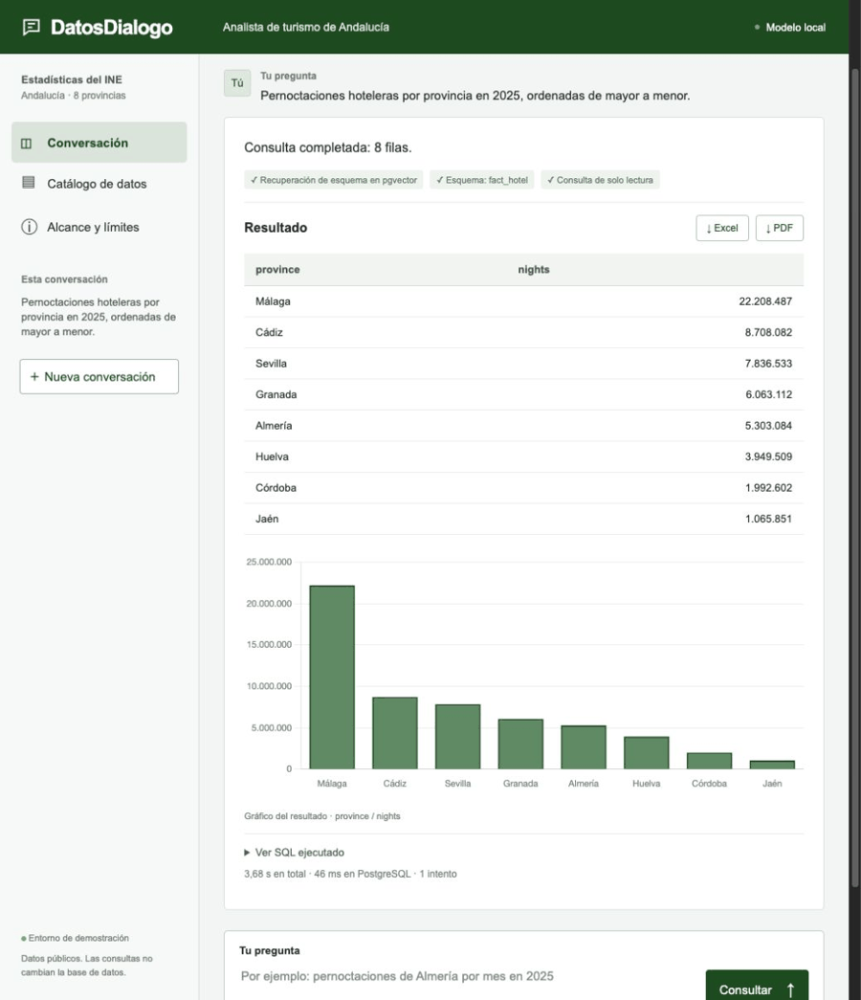
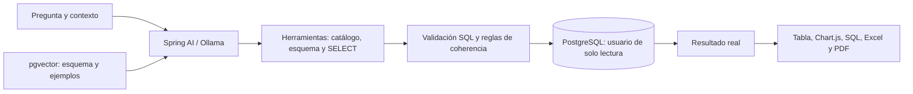

# DatosDialogo

Pregunta en español a los datos turísticos de Andalucía y obtén la tabla, el gráfico y el SQL ejecutado. Un backend Java con Spring AI consulta PostgreSQL mediante herramientas de solo lectura; el modelo se ejecuta localmente con Ollama.



- **Qué hace:** compara provincias, consulta viajeros y pernoctaciones, analiza gasto regional y mantiene el contexto de «¿y en 2024?».
- **Qué devuelve:** datos reales del INE, gráfico Chart.js, SQL desplegable y descarga de la respuesta a Excel o PDF.
- **Cómo está construido:** Spring Boot 3 / Java 21, Thymeleaf, Spring AI, esquema recuperado con pgvector y un usuario SQL sin permiso de escritura.
- **Cómo se comprueba:** 30 pruebas de código y base de datos, más un banco de 40 preguntas ejecutado contra el modelo y comparado con consultas de referencia.
- **Resultado medido:** 31/35 consultas correctas y 5/5 rechazos correctos. Los cuatro casos restantes terminaron sin un resultado válido.

[Resultados y fallos de la evaluación](docs/evaluation.md) · [API y decisiones técnicas](docs/architecture.md) · [Informe de ejemplo](docs/example-report.pdf)

## Arrancar

En un Mac, el [modo Metal](#mac-con-ollama-y-metal) ofrece la experiencia más rápida. La prueba de recorrido completo en CPU tardó 156 segundos; las tres consultas del GIF tardaron 3–4 segundos cada una con Metal.

### Docker Compose, sin cuentas ni claves

```bash
git clone https://github.com/PedroFlores199/DatosDialogo.git
cd DatosDialogo
docker compose up --build -d
docker compose logs -f models app
```

Abre **http://localhost:5104** cuando el servicio `app` esté preparado. La primera ejecución descarga el modelo de chat y el de embeddings, aproximadamente 3 GB en total. Asigna al menos 8 GB de memoria a Docker. La inferencia en CPU tarda más que en un Mac con aceleración Metal; la descarga inicial también necesita conexión.

Las contraseñas del ejemplo solo sirven para la base local de demostración. No hay claves de cuentas, servicios de pago ni conexiones a almacenes privados. El puerto de la aplicación y el de PostgreSQL se publican únicamente en la dirección local del ordenador.

### Mac con Ollama y Metal

Instala [Ollama](https://ollama.com/download). En una terminal, inicia su servicio en el puerto utilizado por este proyecto:

```bash
OLLAMA_HOST=127.0.0.1:11435 ollama serve
```

En otra terminal:

```bash
OLLAMA_HOST=127.0.0.1:11435 ollama pull qwen3:4b-instruct-2507-q4_K_M
OLLAMA_HOST=127.0.0.1:11435 ollama pull nomic-embed-text
docker compose -f compose.yaml -f compose.metal.yaml up --build -d app
```

Si Ollama ya está funcionando en otro puerto, adapta `OLLAMA_URL` en una copia local del fichero de configuración. El modo Metal ejecuta la aplicación y PostgreSQL en Docker, y el modelo en el Mac. Compose 2.24.4 o posterior es necesario para la configuración alternativa.

Para detener la demostración, usa `docker compose down`. Los volúmenes de datos y modelos se conservan.

## Una conversación de ejemplo

1. «Pernoctaciones hoteleras por provincia en 2025, de mayor a menor».
2. «¿Y en 2024?».
3. «¿Y en 2023?».

Las tres capturas del GIF proceden de esa conversación real. Cada respuesta permite desplegar el SQL. El PDF y el Excel corresponden al último resultado disponible en la sesión; un identificador evita descargar por error una respuesta posterior.

## Arquitectura



`Analyst` limita las rondas del modelo y la corrección. `QueryTools` expone las herramientas reales de Spring AI. `SchemaCatalog` recupera descripciones mediante embeddings de 768 dimensiones. `SqlPolicy` y `SemanticRules` revisan la consulta antes de que `ReadonlyQueries` la ejecute. `Exports` genera los archivos a partir del mismo resultado que se muestra en pantalla.

## Qué datos hay

| Tabla | Nivel de detalle | Periodo |
|---|---|---|
| `fact_hotel` | Provincia / mes: viajeros, noches, ocupación, plazas y establecimientos | Octubre 2021-septiembre 2026 |
| `fact_region_monthly` | Andalucía / mes: FRONTUR y EGATUR | Octubre 2021-septiembre 2026 |
| `fact_markets_annual` | Andalucía / país / año: gasto y medidas del viaje | 2016-2025 |
| `fact_housing` | Provincia / captura semestral: viviendas y plazas | Capturas disponibles en la fuente |
| `fact_forecast` | Provincia / mes: previsión orientativa de pernoctaciones | Octubre 2026-marzo 2027 |
| `dim_province`, `dim_date` | Ocho provincias y calendario | Según la captura |

Se reutiliza la capa gold de [TurismoLakehouse](https://github.com/PedroFlores199/TurismoLakehouse), con copia reproducible de siete CSV, manifiestos de las fuentes y sus huellas en [data/provenance.json](data/provenance.json).

El conjunto **no contiene gasto ni turistas británicos por provincia**. Tampoco contiene meteorología ni información personal. 2026 es un año parcial. Una previsión no es una observación. Los valores ausentes permanecen como tales.

La ocupación anual se pondera por plazas y días de mes. La estancia agregada divide noches entre viajeros. Las viviendas son capturas: se selecciona una fecha antes de agregarlas. El gasto anual incluye una fila `Total` que no debe sumarse de nuevo con los países.

## Pruebas

Con Java 21 y Maven 3.9 o posterior:

```bash
docker compose up -d --wait postgres
DIALOGO_TEST_DB_URL=jdbc:postgresql://localhost:55434/dialogo mvn verify
```

Las pruebas verifican escrituras denegadas por PostgreSQL incluso sin el analizador, aislamiento del esquema de embeddings, límite de 200 filas, cancelación de consultas costosas, recuperación tras un timeout, SQL anidado, reglas del indicador, sesiones de exportación, paginación PDF y celdas de Excel que nunca se convierten en fórmulas.

El banco del modelo se ejecuta por separado con la aplicación preparada:

```bash
DIALOGO_EVALUATE_LLM=1 DIALOGO_TEST_DB_URL=jdbc:postgresql://localhost:55434/dialogo mvn -Dtest=AnalystBenchmarkTest test
```

JUnit ejecuta las 40 preguntas de [evaluation/questions.json](evaluation/questions.json), consulta la misma base con el SQL de referencia y escribe el resultado completo en `evaluation/junit-results.json`. El comando devuelve un error si alguna respuesta no coincide; esas discrepancias son precisamente lo que mide el banco. La CI ordinaria no descarga ni simula un modelo.

También hay un evaluador Python equivalente en `evaluation/evaluate.py`, con dependencias indicadas en `evaluation/requirements.txt`. No usa un segundo modelo para juzgar las respuestas.

## Límites del sistema

El banco de 40 preguntas es un conjunto de desarrollo pequeño, utilizado para mejorar el catálogo y los controles. Su resultado no mide la precisión sobre preguntas nuevas. Las comparaciones son estrictas: orden de filas y número de columnas deben coincidir; se ignoran alias y se toleran diferencias numéricas de 0,011.

El analizador SQL y el usuario de lectura restringen lo que puede ejecutarse. Las reglas de coherencia detectan algunos errores de indicador y de grano, pero no demuestran que cualquier consulta represente bien la intención del usuario. Revisa el SQL y el periodo antes de usar una cifra. Los fallos observados están publicados en el informe.

La conversación mantiene como máximo cinco consultas válidas y caduca tras treinta minutos de inactividad. El servidor limita las sesiones y atiende una pregunta a la vez. Se registra el identificador y la huella de cada SQL, su duración y el número de filas; las preguntas y el SQL completo no se escriben en los registros.

Solo se ha implementado y probado el proveedor local Ollama. No se presenta una conexión a Databricks SQL ni a APIs de pago como si estuviera probada.

## Estructura

```text
src/main/java/          Analista, herramientas, validación, consultas y exportación
src/main/resources/     Interfaz, configuración, fuentes y creación de la base
src/test/java/          Pruebas de seguridad, integración, exportación y evaluación
data/                   Captura gold y procedencia
evaluation/             Preguntas, SQL de referencia y resultados reales
docs/                   Capturas, GIF, informe y decisiones
```

Código bajo licencia MIT. Datos y dependencias conservan sus condiciones y atribuciones en [NOTICE.md](NOTICE.md).
